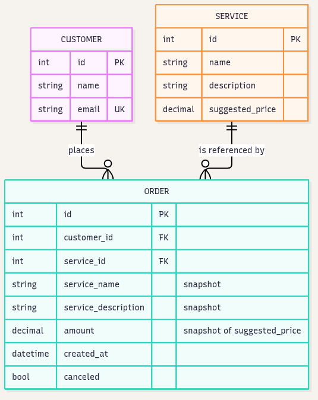

# TinyShop

REST API for managing customers, services, and orders using Python and a
Postgress.

- Language: Python 3.12.
- Framework: FastAPI
- Database: Postgress
- ORM: SQLAlchemy.
- API: REST with JSON responses.

- Design: Database Entity-Relationship (ER) diagram.


- README with installation and execution instructions.
- Automated tests covering the main business rules, including order cancellation and the exclusion of canceled orders from both sales reports.

## Start

Local PostgreSQL, no Docker. Requires Python 3.12, [uv](https://docs.astral.sh/uv/), Node.js, and PostgreSQL 14 or newer (`initdb` on your `PATH`, or in `/usr/lib/postgresql/14/bin`).

```bash
make start
```

That creates a user-owned database on port 5433 the first time, then starts Postgres, the API, and the UI. The API is at http://127.0.0.1:8000 and creates its tables on startup. The UI is at http://127.0.0.1:5173.

To run the same three services in Docker instead:

```bash
make docker
```

Stop that stack with `make docker-stop`.

```bash
make test
make stop
make diagram
```

`make stop` stops the local Postgres. Stop the API and the UI with Ctrl+C. `make diagram` renders the Mermaid diagram in `docs/er.md` to `docs/er.png`.

## Functional Requirements

### Services
- Create services with a name, description, and suggested price.
- Update existing services, including their description and suggested price.
- Retrieve a service by ID.

### Customers
- Register customers with a name and email address.
- Retrieve a customer by ID.

### Orders

- Create orders by associating an existing customer with an existing service.
- Use the service's suggested price as the order amount.
- Retrieve an order by ID.
- Allow existing orders to be canceled.

Business Rule: Orders must retain a snapshot of the service information at the time of creation, including its description and price.

### Sales Reports

Canceled orders must be excluded from both reports.

#### Last 10 Sales
- Implement an endpoint that returns up to 10 orders, sorted from newest to oldest.
- Include the customer, service description, order amount, and creation date for each result.

#### Sales by Customer
- Implement an endpoint that returns a sales summary grouped by customer.
- Include the customer ID and name, total number of orders, and cumulative order amount.
- Sort results by cumulative sales amount in descending order.

