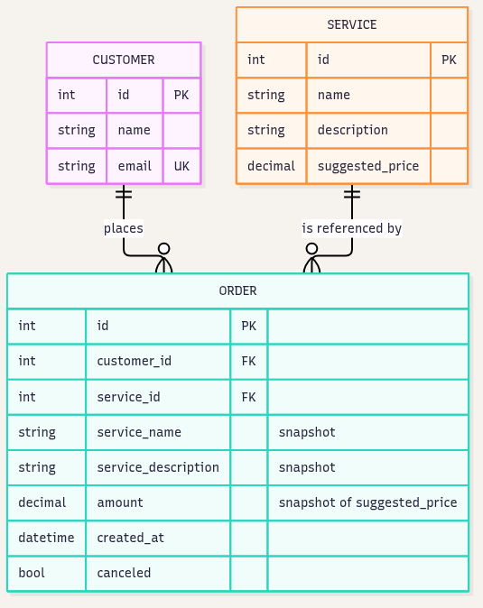
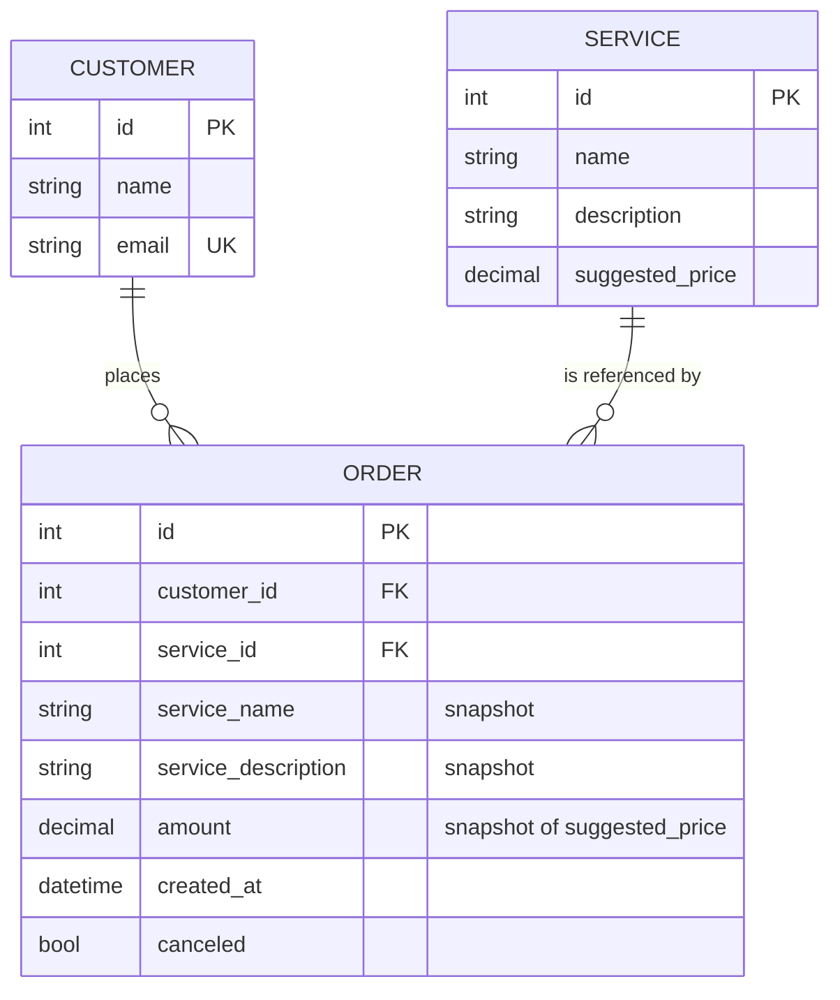

# TinyShop entity-relationship diagram

An order stores a copy of the service name, description, and price from the
moment it is created. Later edits to the service do not change existing orders.

